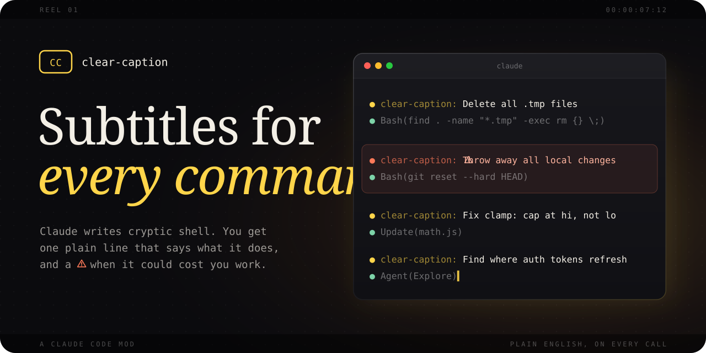

<p align="center">
  
</p>

<p align="center">
  <b>Know what Claude is about to run, in plain English.</b>
</p>

<p align="center">
  <a href=".claude-plugin/plugin.json"></a>
  <a href="LICENSE"></a>
  <a href="https://code.claude.com/docs"></a>
  <a href="CONTRIBUTING.md"></a>
</p>

<p align="center">
  <a href="#install">Install</a> ·
  <a href="#what-you-get">What you get</a> ·
  <a href="#turn-it-up-or-down">Settings</a> ·
  <a href="#good-to-know">Good to know</a> ·
  <a href="CONTRIBUTING.md">Contribute</a>
</p>

---

## Why

You approve commands all day.
Some of them look like this: `find . -name "*.tmp" -exec rm {} \;`

clear-caption adds one quiet line above each call that says what it does.
Your tool rows stay exactly as they were.

**Before**

```
● Bash(find . -name "*.tmp" -exec rm {} \;)
● Bash(git reset --hard HEAD)
● Update(math.js)
```

**After**

```
● clear-caption: Delete all .tmp files
● Bash(find . -name "*.tmp" -exec rm {} \;)
● clear-caption: ⚠ Throw away all local changes
● Bash(git reset --hard HEAD)
● clear-caption: Fix clamp: Math.min should cap at hi, not lo.
● Update(math.js)
```

## Install

Paste this at the Claude Code prompt:

```
/plugin install clear-caption --marketplace KashifManzer/clear-caption
```

Answer `y` to add the marketplace, pick a scope, and you're done.

## What you get

- 💬 **A caption on every shell command and subagent.** It's the call's own description, shown right above its row.
- ✏️ **A caption on every file edit.** One sentence on why the file changes, right above the diff.
- ⚠️ **A warning on risky commands.** Recursive deletes, `git reset --hard`, force-pushes and more get a `⚠`, even when the description sounds harmless.
- 🎨 **Works with your skin.** Captions are their own lines, so skins and other mods that redraw tool rows can't hide them.
- 🤫 **Quiet by design.** Subagents' own calls don't get captions, so a busy subagent won't flood your screen.

<details>
<summary>What counts as risky?</summary>

<br>

The `⚠` shows when the real command:

- deletes recursively (`rm -r`, `rm --recursive`) outside temp folders
- throws away git work (`git reset --hard`, `git clean -f`, `git checkout -- …` or `git checkout .`, `git restore` without `--staged`, `git branch -D`, `git stash drop` or `git stash clear`)
- force-pushes
- deletes by search (`find … -delete`)
- uses `sudo`, pipes `curl` into a shell, or runs `chmod -R`

Deleting only under `/tmp`, `/private/tmp`, `/var/folders`, `$TMPDIR` or a `scratchpad` folder is not marked.
That includes a `$VAR` the same command sets to one of those, like `S=/tmp/run; rm -rf $S`.

It's a short list of common spellings, not a guarantee.
Text inside quotes or heredocs is read as a command too.

</details>

## Turn it up or down

```
/caption all     every caption (default)
/caption risky   only ⚠ captions
/caption off     no captions
/caption         show the current setting
```

Your choice is saved for every session.
Turning edit captions back on with `/caption all` takes effect after `/clear` or in a new session.

## Good to know

- **The caption is Claude's own words.** It can be vague or wrong, so the real command and diff always stay on screen.
- **Edit captions are tested.** 57 of 57 edits got their line across Opus, Sonnet and Haiku. On Opus test tasks the average cost was $0.257 with or without them, for about 3% more output tokens.
- **Rows show a moment later.** A Bash or Agent row waits until Claude finishes writing the call, about 0.4-0.8 seconds for Bash. The call itself doesn't run any later.
- **Built on an early-access API.** Claude Code's mod hooks may change between releases. Tested on Claude Code 2.1.296.

<details>
<summary>The fine print</summary>

<br>

- **How edit captions work.** Edit and Write have no `description` argument, so the mod asks Claude to add one, then strips it out before Claude Code checks the call. The edit runs as usual and the approval dialog shows a clean diff. An edit without the sentence just gets no line. Nothing is refused.
- **Where captions land.** Each caption sits right above its own call, even with parallel calls or batched edits. When Claude Code or a skin folds quick read-only calls (like `ls` and `wc`) into one row, the first caption sits above that row and the rest under it.
- **Spillover.** Twice in about 250 Read calls in testing (both Haiku), Claude added a `description` to Read too. Read ignores it. Grep and Glob refuse it when they're turned on, so such a call would fail once.
- **Removing the mod mid-session.** The note to Claude stays in that session, but nothing strips the extra argument anymore. In testing the next edit failed once, Claude retried without it, and everything after worked. `/clear` or a new session starts clean.
- **A resumed session** (`--resume`) keeps the note it started with.
- **The line names the mod.** Claude Code prefixes every mod's line with its name, so it reads `clear-caption: ...`.
- **Denied calls still get a caption.** The line is logged as soon as Claude has written the call.

</details>

## How it works

Two hooks in [`hooks/register.tsx`](hooks/register.tsx) do the work.
`tool.describe` asks Claude for a one-line `description` on Edit and Write.
`turn.step` holds each call until its arguments arrive, logs the caption with `$.ui.log`, then passes the call on unchanged (edits lose only their `description`).
The pure parts live in [`hooks/label.ts`](hooks/label.ts).

Want to try a local copy without installing?

```
claude --plugin-dir /path/to/clear-caption
```

## Contributing

Bug reports, ideas and PRs are all welcome.
Start with [CONTRIBUTING.md](CONTRIBUTING.md).
Please follow the [Code of Conduct](CODE_OF_CONDUCT.md), and report security issues privately as described in [SECURITY.md](SECURITY.md).

## License

[MIT](LICENSE) © KashifManzer

<p align="center">
  <br>
  If clear-caption saved you a squint, a ⭐ helps other people find it.
  <br><br>
  <sub>Banner type: Instrument Serif and Fira Code, both under the SIL Open Font License.</sub>
</p>
